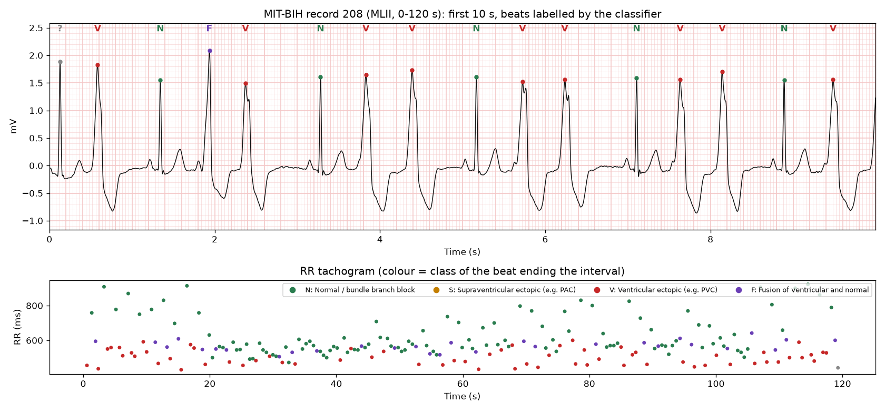

# ECG Signal Lab

**Learn biomedical signal processing by cleaning up real heartbeats and teaching a machine to read them.**

ECG Signal Lab is an open educational project with two halves:

1. **A Python package (`ecglab`)** that filters ECG signals, detects every heartbeat with the Pan-Tompkins
   algorithm, classifies each beat with machine learning (AAMI N / S / V / F classes) and writes a plain-language
   report of what is **normal** and what is **abnormal**.
2. **An interactive website (`docs/`)** that runs the same pipeline in the browser. Learners add real-world
   noise, design filters, watch the detector work stage by stage, inspect the model's decisions beat by beat and
   analyse their own ECG files. It is a static site, so GitHub Pages can host it for free.

All signals come from the **MIT-BIH Arrhythmia Database** and the **MIT-BIH Noise Stress Test Database**
(PhysioNet), the reference datasets used in most published ECG algorithm research.

> **Educational tool only.** This is not a medical device. It has not been clinically validated and must never be
> used to diagnose or treat anyone.



---

## Results (honest, inter-patient evaluation)

The classifier is trained on 22 patients (DS1) and tested on **22 different patients** (DS2), following
de Chazal et al. (2004). The model was chosen by patient-grouped cross-validation on DS1 only; DS2 was never
used to make decisions.

| Stage | Metric | Result |
|---|---|---|
| QRS detection (Pan-Tompkins), all 48 records, 109,494 beats | Sensitivity / positive predictivity | **99.72 % / 99.62 %** |
| Beat classifier (gradient-boosted trees), 49,661 unseen-patient beats | Accuracy | **92.5 %** |
| | Ventricular ectopic (V) sensitivity / precision | **97.8 % / 88.4 %** |
| | Normal (N) sensitivity / precision | 96.0 % / 96.0 % |
| | Abnormal beat (S+V+F) sensitivity / normal specificity | 67.6 % / 96.0 % |
| | ...excluding record 232 (see below) | abnormal sensitivity **90.3 %** |
| Atrial fibrillation screen (RR irregularity), 30 s windows, unseen patients | Sensitivity / specificity | 72 % / 97 % |

Comparison of the four algorithms (test set = unseen patients):

| Algorithm | CV macro-F1 (DS1) | Accuracy | Abnormal Se | Normal Sp | V Se |
|---|---|---|---|---|---|
| Logistic regression | 0.461 | 90.7 % | 66.8 % | 94.7 % | 89.5 % |
| Random forest | 0.521 | 94.0 % | 65.5 % | 98.1 % | 98.3 % |
| **Gradient-boosted trees (chosen)** | **0.543** | 92.5 % | 67.6 % | 96.0 % | 97.8 % |
| Neural network (MLP) | 0.527 | 93.0 % | 68.9 % | 96.9 % | 96.3 % |

**Two lessons are built into these numbers:**

- **The data-leakage trap.** Split the same beats at random, so each patient appears in both training and
  testing, and the very same model scores **98.3 %**. Many published "99 %" ECG classifiers report this inflated
  intra-patient figure.
- **Supraventricular (S) beats are hard.** 75 % of DS2's S beats come from record 232, where the ectopic
  atrial rhythm *is* the patient's usual rhythm. Those beats are neither early nor differently shaped compared with
  the patient's norm, so rhythm- and template-based features cannot catch them. Telling them apart needs P-wave
  analysis. Fusion (F) beats are also rarely recognised.

---

## Quick start

Requires Python 3.10+.

```bash
git clone https://github.com/<your-username>/ecg-signal-lab.git
cd ecg-signal-lab
python -m venv .venv
# Windows: .venv\Scripts\activate    macOS/Linux: source .venv/bin/activate
pip install -e ".[dev]"
```

The trained model ships with the repository (`docs/data/model.json`), so you can analyse your own ECG right away:

```bash
python -m ecglab report --csv my_ecg.csv --fs 250 --column 0 --scale 1
```

`--scale` converts your values to millivolts (use `0.001` for microvolts). The report is written to `reports/`
as Markdown plus a PNG strip chart.

### Reproduce everything from the raw data

```bash
python -m ecglab download            # ~100 MB from PhysioNet (uses the AWS Open Data mirror)
python -m ecglab evaluate-detector   # Pan-Tompkins Se / +P on all 48 records
python -m ecglab train               # 4 models, grouped CV on DS1, final test on DS2 (~5 min)
python -m ecglab report --record 213 --start 180 --duration 60
python -m ecglab calibrate-af        # re-derive the atrial fibrillation threshold
python -m ecglab export-web          # refresh docs/data and the JS parity fixture
pytest                               # 31 tests, including Python vs JavaScript parity
```

If downloads fail with an SSL certificate error (common behind corporate proxies or antivirus software), run
`pip install truststore` and try again: it makes Python use your operating system's certificate store.

---

## The website

Open `docs/index.html` through any static web server:

```bash
python -m http.server 8000 --directory docs     # then visit http://localhost:8000
```

(Opening the file directly with `file://` will not work, because browsers block `fetch` of local files.)

### Publish it on GitHub Pages

1. Push this repository to GitHub.
2. Go to **Settings -> Pages**. Under *Build and deployment*, choose **Deploy from a branch**, then
   branch **main** and folder **/docs**, and save.
3. After a minute the site is live at `https://<your-username>.github.io/ecg-signal-lab/`.

### Lessons

| # | Lesson | What learners do |
|---|---|---|
| 1 | The ECG signal | See P-QRS-T on clinical ECG paper and each patient's median beat |
| 2 | Where noise comes from | Mix in *real* baseline wander, muscle and electrode-motion noise plus 50/60 Hz hum, and see where each lives in the spectrum |
| 3 | Designing the filter | Tune high-pass, low-pass and notch filters, order, zero-phase vs causal. Live SNR, residual noise, distortion and R-wave preservation; see a causal filter fake an "ST depression" |
| 4 | Finding every heartbeat | Watch each Pan-Tompkins stage and its adaptive threshold; detections are scored against the cardiologists |
| 5 | Classifying beats with ML | Click any beat to see its features, its template and the model's probabilities; review confusion matrices, an algorithm comparison and per-patient results |
| 6 | The report | Normal/abnormal verdict, findings, HRV, an RR tachogram, and *analyse your own CSV* (processed locally, never uploaded) |

---

## How it works

```
raw ECG -> band-pass 0.5-40 Hz (zero-phase Butterworth) -> Pan-Tompkins QRS detection
        -> 46 features per beat -> gradient-boosted trees -> N / S / V / F
        -> rhythm rules (rate, ectopy patterns, pauses, irregularity) -> report
```

**Filtering** (`ecglab/filters.py`). Cascaded second-order sections. The defaults use a 0.5 Hz high-pass for
baseline wander and a 40 Hz low-pass for EMG and mains hum, applied forward-backward (`sosfiltfilt`), so there is no
phase distortion. That is what makes a 0.5 Hz cut-off acceptable for the ST segment (AHA 2007). A two-stage
median-filter baseline and an IIR notch are also included.

**Detection** (`ecglab/detect.py`). Pan & Tompkins (1985): 5-15 Hz band-pass, derivative, squaring, 150 ms
moving-window integration and adaptive signal/noise thresholds, with search-back and T-wave rejection.
Detections are scored with the AAMI EC57 150 ms matching window.

**Features** (`ecglab/features.py`), 46 per beat:

- 10 RR-interval features: pre/post/local/long-term RR and their ratios (prematurity, compensatory pause);
- 10 template features: correlation, amplitude, energy and QRS width compared with the patient's own median beat
  (an unsupervised, label-free form of patient adaptation);
- 26 amplitude-normalised morphology samples from -250 ms to +450 ms.

**Classification** (`ecglab/model.py`). Logistic regression, random forest, histogram gradient boosting and an
MLP, with class weighting for the heavy imbalance (90 % of beats are normal). The paced records 102, 104, 107 and
217 are excluded, as AAMI recommends.

**Report** (`ecglab/rhythm.py`, `ecglab/report.py`). Heart rate, brady/tachycardia, SDNN/RMSSD/pNN50, ectopic
burden, couplets, runs (non-sustained VT), bigeminy and trigeminy, pauses longer than 2 s, and an atrial
fibrillation screen. The AF screen uses an RR irregularity index minimised over lags 1-3, which keeps
"regularly irregular" bigeminy from being mistaken for AF.

**Browser port** (`docs/js/`). The website re-implements the filters (including SciPy's `sosfiltfilt` padding
and initial conditions), the detector, the features, the model and the rhythm rules in plain JavaScript, with no
build step and no dependencies. `tests/test_js_parity.py` runs it under Node.js and checks that it reproduces the
Python output: the same filtered signal, the same R peaks, the same features and the same probabilities.

## Project layout

```
ecglab/            Python package
  data.py          PhysioNet download, record loading, AAMI classes, DS1/DS2 split
  filters.py       Butterworth / notch / median filters, SNR, spectra
  detect.py        Pan-Tompkins detector and beat matching
  features.py      RR, template and morphology features
  model.py         training, inter-patient evaluation, JSON model inference
  rhythm.py        rhythm metrics, findings, AF calibration
  report.py        end-to-end analysis, Markdown + PNG report
  export_web.py    exports data and model for the website
docs/              the website (GitHub Pages root)
  index.html, css/, js/ (dsp, qrs, features, model, report, plot, app)
  data/            10 one-minute MIT-BIH excerpts, noise clips, model.json, metrics.json
tests/             pytest suite + Node.js parity harness
```

## Limitations and ideas for extension

- Single lead (MLII), 1970s ambulatory recordings, 47 patients: performance on other populations, devices or
  leads is unknown.
- S and F beats are poorly recognised; P-wave features, patient-specific fine-tuning, or 1-D CNNs on raw
  waveforms are natural next steps.
- Try PTB-XL (12-lead, 21,799 records) for rhythm and morphology diagnoses beyond beat classes.

## Data and licences

- Code: MIT License (see `LICENSE`).
- MIT-BIH Arrhythmia Database and MIT-BIH Noise Stress Test Database: Open Data Commons Attribution License
  v1.0, via PhysioNet. The site includes ten one-minute excerpts and three one-minute noise clips. Please cite:
  - Moody GB, Mark RG. The impact of the MIT-BIH Arrhythmia Database. *IEEE Eng Med Biol* 20(3):45-50, 2001.
  - Moody GB, Muldrow WE, Mark RG. A noise stress test for arrhythmia detectors. *Computers in Cardiology* 11:381-384, 1984.
  - Goldberger AL, et al. PhysioBank, PhysioToolkit, and PhysioNet. *Circulation* 101(23):e215-e220, 2000.

## References

- Pan J, Tompkins WJ. A real-time QRS detection algorithm. *IEEE Trans Biomed Eng* 32(3):230-236, 1985.
- de Chazal P, O'Dwyer M, Reilly RB. Automatic classification of heartbeats using ECG morphology and heartbeat
  interval features. *IEEE Trans Biomed Eng* 51(7):1196-1206, 2004.
- ANSI/AAMI EC57: Testing and reporting performance results of cardiac rhythm and ST segment measurement algorithms.
- Kligfield P, et al. Recommendations for the standardization and interpretation of the electrocardiogram, Part I.
  *Circulation* 115:1306-1324, 2007.
